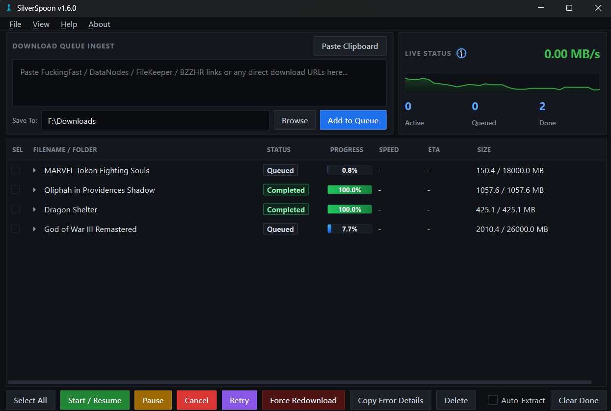
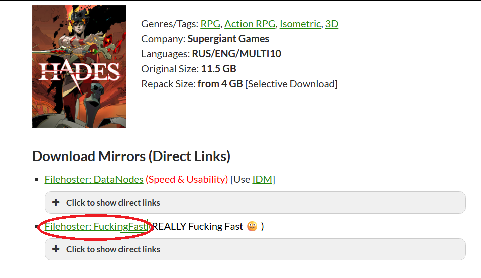
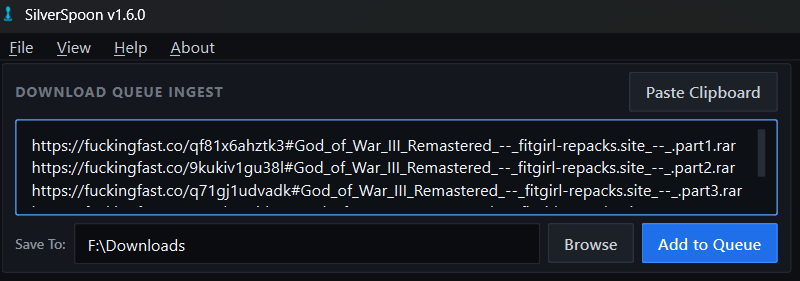
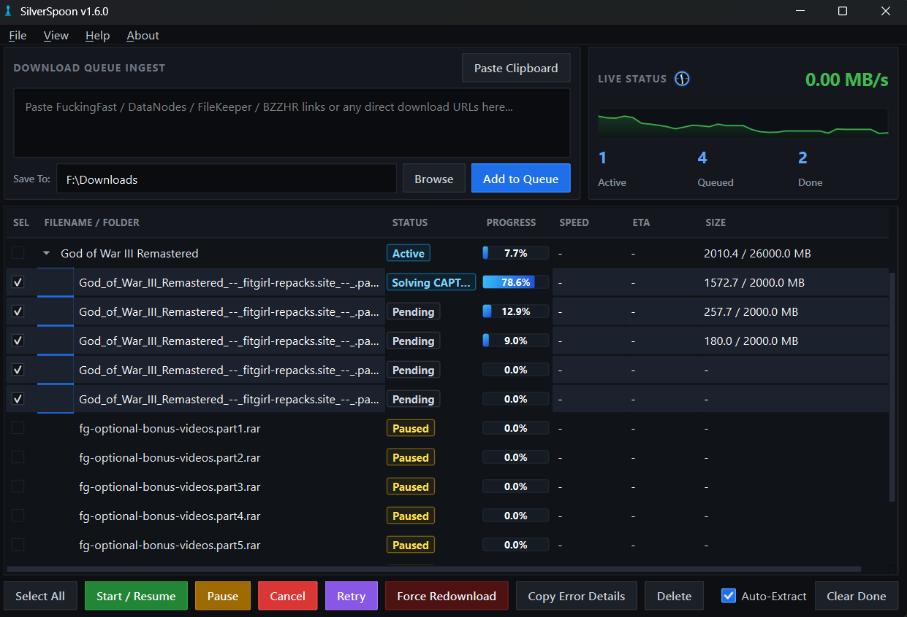

# SilverSpoon (previously FitGirlDownloader)

A Python bulk downloader for file hosts used by FitGirl Repacks, SteamRIP and similar sites. Paste a batch of links and SilverSpoon gets past each host's Cloudflare check or countdown, fetches the real download links, and downloads everything in parallel with pause, resume and automatic extraction. Ordinary direct download links can be queued alongside them.

## Supported Hosts

| Host | How links are resolved |
|---|---|
| `fuckingfast.co` | Built-in Cloudflare Turnstile solver (hidden Chromium browser) |
| `datanodes.to` | Built-in solver, including DataNodes' two-step download page and countdown |
| `bzzhr.to` | Built-in solver for the site's Cloudflare check; the file then downloads with multiple connections |
| `filekeeper.net` | Plain HTTP: waits out the countdown and requests the link, no browser needed |
| Any other `http(s)` link | Downloaded directly, with multiple connections when the server allows it |

## Features

**Downloading**
* **Multi-Connection Downloads:** Direct links download over several parallel connections (default 4, `File -> Settings -> Connections per Download`; 1 turns it off). Each part is written straight into one file, and progress is saved beside it so pause and app restarts resume where every part stopped. Hosts that refuse extra connections are handled by carrying on with fewer.
* **Concurrent Queue:** Downloads several files at once (default 3, customizable in Settings) with a live global speed graph and per-file and per-batch ETAs.
* **Pause, Resume & Retry:** Pause anytime, recover from network drops, or retry failed links; resumes use HTTP `Range` requests. Optional auto-retry (up to 3 times).
* **Bandwidth Limiter:** A global speed limit in Settings reserves bandwidth for other apps.
* **Real File Names:** Links without a file name (such as `bzzhr.to/<id>`) use the name the server sends.

**Cloudflare & CAPTCHAs**
* **Background Solver:** A Chromium browser (via `nodriver`) passes Cloudflare Turnstile checks automatically. It runs off-screen, so no window pops up for every link.
* **Pops Up Only When Needed:** If a check wants a human click ("Verify you are human"), the browser window comes to the front, the task shows **Waiting for you to solve CAPTCHA**, and you get extra time to complete it; it hides again afterwards. `File -> Settings -> Show the CAPTCHA browser window` keeps it visible.
* **Self-Healing:** A failed resolution closes the browser instead of reusing a broken one, so it never re-spawns endlessly.

**Extraction**
* **Auto-Extract:** Tick **Auto-Extract** and each finished batch is extracted with the bundled 7-Zip on Windows, or `7z`/`7zz` on Linux and macOS.
* **Progress & Cancel:** A progress bar shows extraction progress for each task and batch; **Cancel** stops it, and **Extract Now** resumes later.
* **Skips Finished Work:** Auto-extract skips batches whose files are already on disk with the right sizes, and **Extract Now** asks before overwriting an extracted batch.

**Queue & Workflow**
* **Grouped Batch Folders:** Downloads are grouped into collapsible batch folders with aggregated progress, speed and ETA. A folder name is suggested so main parts and optional files land together.
* **Smart Clipboard & Import:** Paste text or rich HTML (e.g. a copied table) and SilverSpoon extracts the links, or import a `.txt` list.
* **Download Scheduler:** Download automatically during an off-peak window (weekly or one-off), with optional Windows wake timers and sleep prevention.
* **Persistent History & Settings:** Your queue, progress, folders and preferences survive restarts.
* **Single Instance:** Only one copy runs at a time, so two windows can't corrupt the shared queue.
* **Auto-Updater (Windows):** New releases are added to your download queue; when one finishes, choose **Install now** or **Install on next open**.
* **Diagnostics & Shortcuts:** Error tooltips, **Copy Error Details**, right-click actions (Extract Now, Open Folder, Retry, Force Redownload, scheduling) and keyboard shortcuts (`Space` to pause/resume, `Delete` to remove).
* **Dark & Light Themes**, plus a lightweight **command-line** script.

## Requirements

* Python 3.10+
* Dependencies listed in `requirements.txt`
* For FuckingFast, DataNodes and BZZHR: a Chromium-based browser. The Windows release bundles one; from source on Windows or Linux, an installed Chrome, Chromium, Edge or Brave works, or install Playwright's with `python -m playwright install chromium`. (The solver doesn't look for browsers on macOS yet, so those hosts don't work there; FileKeeper and direct links do.)
* For extraction on Linux/macOS: 7-Zip (`7zip` or `p7zip` package). Windows uses the bundled `7z.exe`.

## Installation

1. Clone this repository:
   ```bash
   git clone https://github.com/billysams21/SilverSpoon.git
   cd SilverSpoon
   ```
2. Install the required Python packages (or do it inside a virtual environment):
   ```bash
   pip install -r requirements.txt
   ```

Or download the ready-made Windows build (`SilverSpoon-windows.zip`) from the [Releases](https://github.com/billysams21/SilverSpoon/releases) page.

## Usage

### Using the GUI (Recommended)
Launch the graphical interface (or double-click `SilverSpoon.exe`):
```bash
python pyqt_downloader.py
```



1. Click **Browse** to select your base save directory (or set a default in `File -> Settings`).
2. Open the game page and pick a mirror (FuckingFast, DataNodes, FileKeeper, or BZZHR on SteamRIP). Plain direct links from any other host can be pasted as-is.

3. Copy the links you want to download.
4. Paste your links into the top text box (one per line) or use `File -> Import Links from File...`. You can also copy links or tables straight from your browser and click **Paste Clipboard**; SilverSpoon extracts the URLs from rich HTML clipboard data.

5. Click **Add to Queue** and confirm the batch folder name, so all main and optional files go to the same place.
6. Click **Select All** (or tick individual boxes) for the files you want to download.
7. (Optional) Tick **Auto-Extract** to extract each batch automatically once all its parts are downloaded.
8. Click **Start / Resume** to begin downloading.

9. Use **Pause**, **Cancel** and **Start / Resume** to manage your selected downloads at any time. If the CAPTCHA browser pops up, complete the check and the download continues.

### Useful Settings (`File -> Settings`)
* **Max Concurrent Downloads**: how many files download at once.
* **Connections per Download**: parallel connections per file for direct links (1 = off).
* **Global Bandwidth Limit**: total speed cap.
* **CAPTCHA Solve Timeout** and **Show the CAPTCHA browser window**: how long the solver waits on its own, and whether its window stays visible.
* **Extract after download by default** and **Automatically retry failed downloads**.

### Download Scheduler
Queue your links, then let SilverSpoon download them automatically during a chosen window (e.g. off-peak hours):
1. Add and select your links as usual, but leave them **paused/queued** (don't press Start).
2. Open `File -> Download Scheduler` (or right-click one or more downloads and choose **Schedule download at specific interval** to schedule only those instead of the whole queue).
3. Set the **Start** and **End** times using the hour / minute / AM–PM dropdowns. If the end is earlier than the start, the window is treated as crossing midnight (e.g. `11:00 PM`–`5:00 AM`).
4. Choose **Repeat weekly** (and pick the active days) or **Run once** on a specific date.
5. *(Optional, Windows)* Tick **Wake the computer to run downloads** to register a Windows wake timer that powers the PC on and launches SilverSpoon when the window starts. Leave **Keep the computer awake** on so it doesn't sleep mid-download.
6. Click **Add Schedule**. When the window opens, SilverSpoon verifies your connection and starts the scheduled downloads; when it closes, it pauses them and shows a summary (also saved to `~/.silverspoon_offpeak_report.jsonl`).

> **Note:** The wake timer is Windows-only. On Linux/macOS the app still auto-starts and keeps the display awake while it is running, but it cannot power the machine on from a fully off state. If SilverSpoon is already open when the wake timer fires, the new launch exits quietly and the running window handles the schedule.

### Using the CLI
For servers or automation:
1. Put your links into `link.txt` (one per line).
2. Run the script:
   ```bash
   python downloader.py link.txt
   ```
*(Files are downloaded to the current working directory. The CLI handles the browser-solved hosts: FuckingFast, DataNodes and BZZHR. FileKeeper, plain direct links, multi-connection downloads and extraction are GUI-only.)*

## Building the Windows executable

Run `build_exe.bat` (needs `pyinstaller` and a Playwright Chromium under `%LOCALAPPDATA%\ms-playwright`); the distributable folder lands in `dist\SilverSpoon`. Pushing a `v*.*.*` tag runs the same build on GitHub Actions and attaches `SilverSpoon-windows.zip` to the release.

## Contributing

We welcome contributions! See the [Contributing Guide](CONTRIBUTING.md) for how to set up your environment, follow the branching strategy (`dev` branch) and submit Pull Requests. The headless tests run with `python test_<name>.py` (e.g. `python test_providers.py`), and GitHub Actions runs all of them on every push and pull request.

## Changelog

Detailed release notes and history of changes can be found in the [CHANGELOG.md](CHANGELOG.md) file.

## Disclaimer

This tool is provided for educational and automation purposes only. The author is not responsible for the content downloaded using this tool. Please respect the terms of service of the file-hosting providers.
